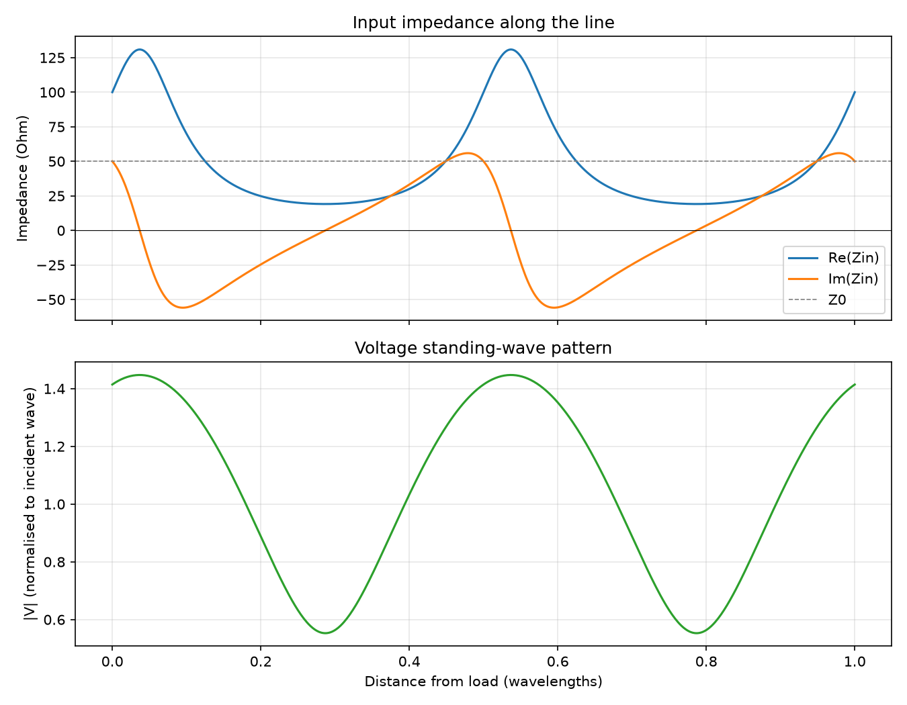

# Transmission Line Toolkit

[](https://github.com/<your-username>/transmission-line-toolkit/actions/workflows/ci.yml)


A small Python library and command-line tool for **transmission-line analysis and
impedance matching**. Give it a line impedance, a load and a frequency; it tells you the
reflection coefficient, VSWR and losses, and designs matching networks that it then
**verifies by recomputing the impedance** after matching.

## Features

- **Load analysis** – reflection coefficient, VSWR, return loss, mismatch loss, reflected / delivered power.
- **Input impedance** along a line of any length, lossless or lossy, with a velocity factor.
- **Matching networks**, each solution self-checked:
  - quarter-wave transformer (directly at a real load, or at the points where `Zin` is real);
  - L-network with lumped components (both topologies, values in nH / pF);
  - single shunt stub (open or short-circuited), closed-form solution.
- **Sweeps** of `Zin`, VSWR and the voltage standing-wave pattern, exportable to CSV and plots.
- **Web app** (Streamlit): live metrics, matching designs in tables, interactive plots, CSV download.
- **Command-line interface** (`tlmatch`) with an interactive mode, plus a clean Python API.
- Tested with `pytest`; independent checks rebuild `Zin` from the component values.

## Installation

```bash
git clone https://github.com/<Hoagncoder>/transmission-line-toolkit.git
cd transmission-line-toolkit
pip install -e ".[plot]"        # CLI + matplotlib plots
pip install -e ".[web]"         # web app (Streamlit + Plotly)
pip install -e ".[dev]"         # everything, plus pytest and ruff
```

Requires Python 3.9+ and NumPy. Matplotlib is optional (only needed for plots).

## Command-line usage

```bash
tlmatch analyze --z0 50 --zl 100+50j
tlmatch match   --zl 100+j50 --freq 1GHz
tlmatch match   --zl 75 --freq 2.4GHz --vf 0.66 --stub-termination short
tlmatch zin     --zl 100+j50 --freq 1GHz --length-lambda 0.1
tlmatch sweep   --zl 100+j50 --freq 1GHz --max-lambda 1 --plot sweep.png --csv sweep.csv
tlmatch interactive             # prompts for each value
```

- Impedances: `75`, `100+50j` or `100+j50`. Frequencies: `1e9`, `900MHz`, `2.4GHz`.
- `--z0` defaults to 50 Ohm; `--vf` is the velocity factor in (0, 1].
- `python -m tltoolkit ...` works too. Invalid input exits with code 2 and a clear message.

### Example

```text
$ tlmatch match --zl 100+j50 --freq 1GHz

Load analysis
  Z0                 : 50.0000 Ohm
  ZL                 : 100.0000 + j50.0000 Ohm
  Gamma              : 0.40000 + j0.20000
  |Gamma|            : 0.44721
  angle(Gamma)       : 26.565 deg
  VSWR               : 2.6180
  Return loss        : 6.9897 dB
  Mismatch loss      : 0.9691 dB
  Reflected power    : 20.000 %
  Delivered power    : 80.000 %

Quarter-wave transformer
  Complex load: place the transformer where the line impedance is purely real.
  Solution 1:
    Place at d = 0.03690 lambda (0.01106 m) from the load, where Zin = 130.9017 Ohm
    Z1 = 80.9017 Ohm, length = 0.25 lambda
    Check: Zin = 50.000000 + j0.000000 Ohm, error = 7.74e-15 Ohm -> OK
  ...
L-network (lumped elements)
  Solution 1: shunt element across the load, series element towards the source
    Series: X = +61.2372 Ohm -> inductor L = 9.7462 nH
    Shunt : B = +0.013798 S -> capacitor C = 2.1960 pF
    Check: Zin = 50.000000 + j0.000000 Ohm, error = 1.42e-14 Ohm -> OK
  ...
Single shunt stub (open-circuited)
  Solution 1:
    Stub position d = 0.19879 lambda (0.05960 m) from the load
    Stub length   l = 0.37500 lambda (0.11242 m), open-circuited
    Check: Y_total/Y0 = 1.000000 - j0.000000, error = 7.85e-16 -> OK
  ...
```

`tlmatch sweep` produces a plot like this:



## Web app

```bash
pip install -e ".[web]"
streamlit run web/app.py
```

Then open <http://localhost:8501>.

- **Sidebar**: line impedance, load as R + jX, frequency with unit, example loads, and advanced
  options (velocity factor, stub type, sweep length, attenuation).
- **Analysis tab**: VSWR, |Γ|, return loss, mismatch loss, a colour-coded verdict and the power split.
- **Matching tab**: quarter-wave, L-network and single-stub designs as tables, each marked ✓ when
  verified, with the residual error.
- **Sweep tab**: interactive Plotly charts of `Zin` and the standing-wave pattern (hover, zoom, PNG via
  the chart toolbar), dotted lines at the planes where `Zin` is real, and a CSV download.

The app contains no formulas: it only calls `tltoolkit` and displays the results.

### Deploying (free)

1. Push the repository to GitHub.
2. On [Streamlit Community Cloud](https://share.streamlit.io) choose **New app**, select the repository,
   and set the main file to `web/app.py`. The root `requirements.txt` installs everything needed.
3. Add the public URL to this README.

## Python API

```python
from tltoolkit import analyze_load, recommend_matching, l_network_match, single_stub_match

a = analyze_load(50, 100 + 50j)
print(a.vswr, a.return_loss_db)

for s in l_network_match(50, 100 + 50j, 1e9):
    print(s.topology.name, s.series_component, s.shunt_component, s.matched)

for s in single_stub_match(50, 100 + 50j, 1e9, termination="short"):
    print(f"d = {s.d_lambda:.4f} lambda, l = {s.l_lambda:.4f} lambda")

report = recommend_matching(50, 100 + 50j, 1e9)  # everything at once
```

Functions return dataclasses with **numeric** values (ohms, farads, henries, metres);
text formatting lives separately in `tltoolkit.reporting`.

## Project layout

```
src/tltoolkit/
    line.py        reflection coefficient, VSWR, losses, input impedance
    matching.py    quarter-wave, L-network, single stub
    analysis.py    analyze_load, recommend_matching, sweep_impedance
    reporting.py   text formatting
    plotting.py    matplotlib figures (optional dependency)
    cli.py         the `tlmatch` command
web/
    app.py         Streamlit app
    ui_helpers.py  pure helper functions used by the app
tests/             pytest suite (library, CLI and web app)
examples/demo.py   runnable example
```

## Theory and conventions

- `Gamma = (ZL - Z0) / (ZL + Z0)`, `VSWR = (1 + |Gamma|) / (1 - |Gamma|)`
- `Zin(d) = Z0 (ZL + Z0 tanh(gamma d)) / (Z0 + ZL tanh(gamma d))`, `gamma = alpha + j beta`
- Quarter-wave transformer: `Z1 = sqrt(Z0 * R)`
- Time convention `exp(+j w t)`; distances are measured from the load towards the source.
- Open circuit is `float("inf")`; the speed of light is `299 792 458 m/s` scaled by `--vf`.

## Limitations

- Matching designs assume a **lossless** main line with real `Z0` and a **single design frequency**;
  bandwidth is not optimised.
- Lumped components are ideal (no parasitics).
- Open, short and purely reactive loads absorb no power; the tool reports this instead of designing a network.
- `alpha` (attenuation) is supported by `input_impedance`, `zin` and `sweep`, not by the matching routines.

## Development

```bash
pip install -e ".[dev]"
ruff check . && pytest
```

## References

- D. M. Pozar, *Microwave Engineering*, 4th ed., Wiley – chapters 2 and 5.

## License


